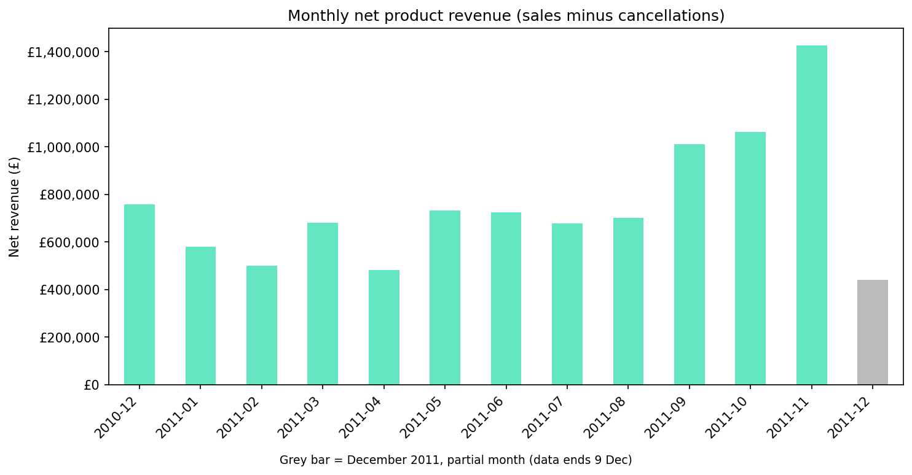
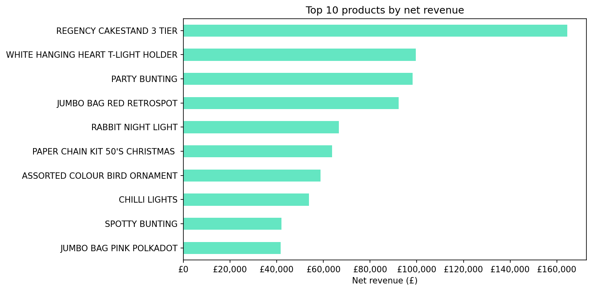
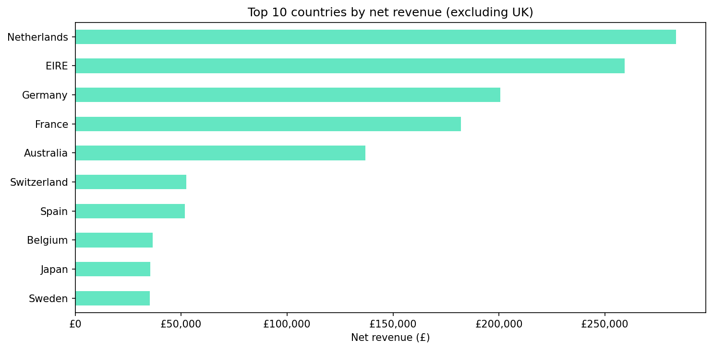
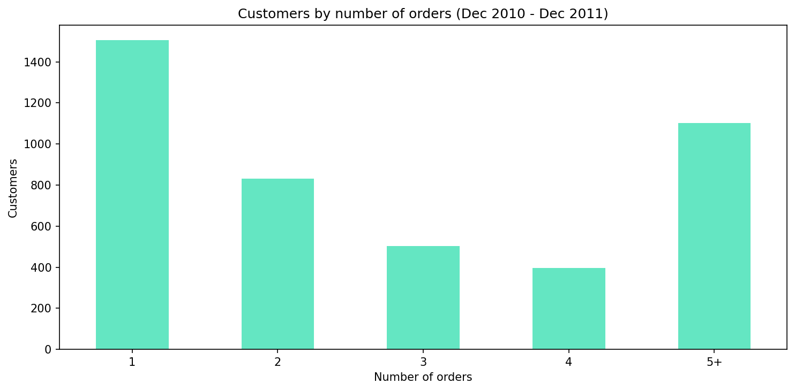

# E-commerce Customer Behaviour Analysis

An analysis of one year of transactions from a UK-based online gift retailer, covering revenue trends, best-selling products, countries and repeat customers. The focus was on cleaning the data carefully and only stating what the data supports.

**Tools:** Python (pandas, matplotlib) in Google Colab

**Notebook:** [ecommerce_customer_behaviour.ipynb](ecommerce_customer_behaviour.ipynb)

## Business questions

1. How did net revenue change over the year?
2. Which products and countries generate the most revenue?
3. How many customers come back, and how much revenue do they bring?

## Data

[UCI Online Retail dataset](https://archive.ics.uci.edu/dataset/352/online+retail): 541,909 transaction rows, 1 December 2010 to 9 December 2011, 38 countries. Columns: invoice number, stock code, description, quantity, invoice date, unit price, customer ID, country.

## Data cleaning

| Step | Result |
|---|---|
| Exact duplicate rows removed | 5,268 |
| Cancellation invoices (start with "C") set aside, not deleted | 9,251 rows |
| Non-cancelled rows with zero or negative quantity or price removed (stock adjustments, "damaged", "check", missing descriptions) | 2,512 rows |
| Postage, carriage, manual adjustments, bank charges and gift vouchers set aside (not products) | 2,340 rows |
| Product sales rows remaining | 522,538 |

**Two data-entry errors found.** The two largest single order lines were orders of about 81,000 and 74,000 units, cancelled 12 and 16 minutes later. They ranked second and sixth among products by gross revenue. Together they were about £246k of gross revenue. They were removed from the customer analysis and netted off in the revenue analysis. Without this step, the product ranking and the December 2011 revenue would have been wrong.

**Net revenue** is gross product sales minus product cancellations, with each cancellation counted in the month it was made. Gross product revenue was £10.25M, cancellations were £0.48M (4.6%), and net product revenue was **£9.77M**.

## Findings

### Monthly net revenue

- Net revenue ranged from about £480k to £760k per month from December 2010 to August 2011.
- It was higher in autumn 2011: about £1.01M in September, £1.06M in October and £1.43M in November.
- December 2011 (grey bar) contains only 9 days of data, so it is not a decline.

### Top products

- The top five by net revenue were Regency Cakestand 3 Tier (about £164k), White Hanging Heart T-Light Holder, Party Bunting, Jumbo Bag Red Retrospot and Rabbit Night Light.

### Countries

- The United Kingdom accounts for about 85% (84.8%) of net product revenue.
- Outside the UK, the leading countries are the Netherlands (£283k), Ireland (£259k), Germany (£201k), France (£182k) and Australia (£137k).

### Customers

| Measure | Value |
|---|---|
| Identified customers analysed | 4,333 |
| Repeat customers (2 or more orders) | 2,828 (65.3%) |
| Share of customer revenue from repeat customers | 93.5% |
| Share of customer revenue from the top 10% of customers | 60.3% |
| Median orders per customer | 2 |
| Average order value | £461.50 |
| Median order value | £301.63 |

- About two in three identified customers ordered more than once, and they generated almost all of the customer revenue.
- Revenue is concentrated: the top 10% of customers account for about 60%.
- The average order is well above the median, so a minority of large orders pull the average up. The median is the better guide to a typical order.

## Limitations

- Only one year of data, so the autumn increase is an observation and not evidence of a seasonal pattern.
- About 25% of rows have no customer ID. Customer figures cover identified customers only.
- Customer figures use sales before cancellations (apart from the two entry errors), so they should not be compared directly with the net revenue figures.
- Cancellations are matched by date and not linked to specific original orders. Cancellations of orders placed before December 2010 cannot be traced.
- The repeat rate is measured over 12 months. Customers who first bought late in the year had little time to return, so it is probably understated.
- Average order values suggest many customers are trade buyers, not typical consumers.
- The data cannot explain why revenue changed or why particular countries or products performed as they did.

## Reproduce

Open the notebook in Google Colab and run the cells in order. The notebook downloads the public dataset directly.
